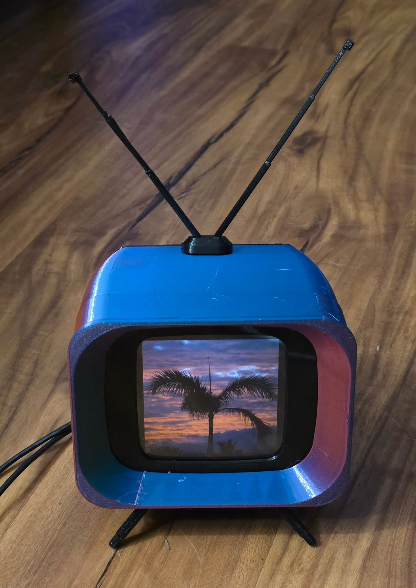
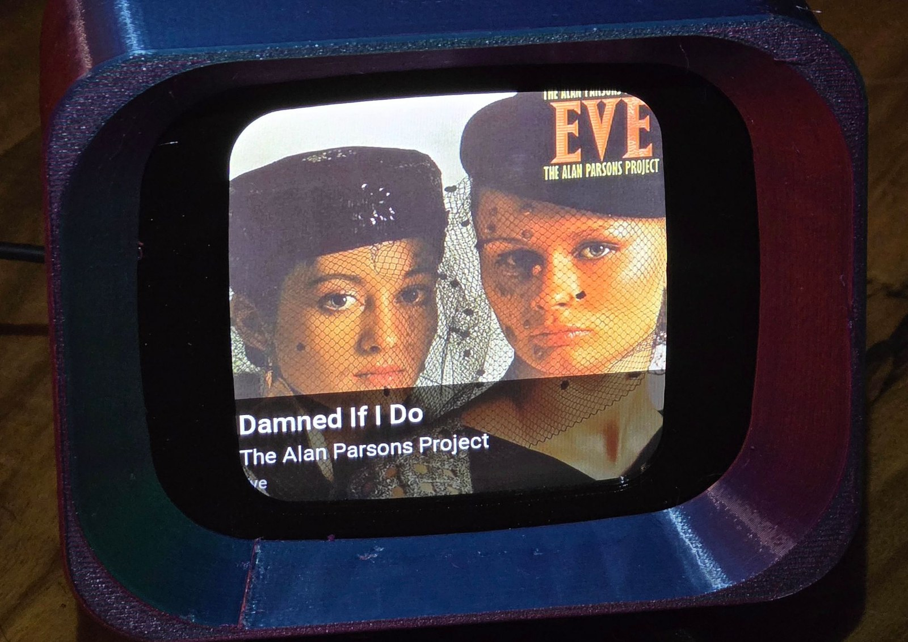

# Now Playing display

I designed and 3D printed a little 1950s-style TV, rabbit ears and legs and
all, with a 4 inch screen in it. It listens to the room, and when a song comes
on the real TV it works out what the song is and puts the album cover up with
the title and artist, usually within about 20 seconds. When there's no music it
cycles through my own photos. I built the case and the software behind it.

<p align="center">
  
  &nbsp;
  
</p>
<p align="center"><em>Left: no music, so it cycles through my photos. Right: a song it just heard.</em></p>

The rest of this page is the build log and the technical notes.

## In short

A small server program listens to a room all the time, decides on its own
whether it is hearing a song or just people talking, identifies the song, and
publishes the title, artist, album and cover for a 480x480 ESP32 touch panel and
for Home Assistant.

**Where it stands (2026-11-12).** The whole chain runs on real hardware. The
recognition daemon is installed as a service on a Raspberry Pi Zero 2 W
(`PiDisplay`, 10.0.0.61) that will live inside the TV case, next to a Mosquitto
broker on the same Pi. The panel is flashed with the firmware in
`display/esphome` and is on Wi-Fi as `now-playing-display` (10.0.0.115). The Pi
names songs within seconds and the panel downloads and shows their covers.
Still missing: a microphone wired to the Pi (for now the sound reaches it over
the network, from a laptop's microphone or an internet radio stream), the link
to Home Assistant, and a check of the touch position. "Current setup" below has
the details. The daemon also has 306 unit tests, run on the PC it was written on.

## How it works

```
  microphone / camera RTSP / UDP / radio stream
            |   ffmpeg, always running
            v
     30 s ring buffer --- level meter ---> silence: nothing to do
            |
            v   once a second, on this machine, no network
     music detector (YAMNet) -----------> talk, noise: no lookup
            |  music
            v   at most 3 requests a minute
     recognizers in order:  shazam -> (audd) -> (acoustid)
            |
            v
     tracker: holds the track through a missed lookup, asks for a second
            |  opinion on a doubtful answer, clears when the music stops
            |
            +--> cover art: recognizer's link -> Cover Art Archive -> iTunes -> generated
            |        converted to one 480x480 baseline JPEG, cached, served over HTTP
            v
     MQTT: state (retained JSON), availability, audio report, HA discovery
            |                                   ^ commands: listening, identify, external
            v                                   |
     ESP32-S3 panel (ESPHome + LVGL)       Home Assistant
```

The panel is deliberately dumb: it subscribes to one retained MQTT topic and
loads one small JPEG per track from this server over plain HTTP.

## Current setup (built 2026-11-11)

| Piece | Where | Notes |
|---|---|---|
| Recognition daemon | Pi Zero 2 W `PiDisplay`, 10.0.0.61, Raspberry Pi OS Lite 64-bit (Debian 13, Python 3.13) | service `now-playing`; program in `/opt/now-playing`; config `/etc/now-playing/config.toml` (a copy is `deploy/pi-zero-config.toml`); login in `/etc/now-playing/secrets.env` |
| MQTT broker | Mosquitto on the same Pi, port 1883 | one login, user `nowplaying`; anonymous clients are refused. Home Assistant is not connected to it yet |
| Cover server | the daemon, http://10.0.0.61:8777 | `/` is a browser preview of what the panel shows |
| Panel | Guition ESP32-S3-4848S040, `now-playing-display`, 10.0.0.115 | flashed over USB with ESPHome 2026.10.2; the built-in display model draws correctly on this unit |
| Audio input | an internet radio stream (`[capture]` in the config) | stands in until a microphone is on the Pi |
| Picture size | 450 x 450, set by `artwork.size` on the Pi and `resize:` in the firmware | a little larger than the 420 square the case's mask shows in full, see "The visible square" |
| Idle pictures | `/srv/now-playing/slides` on the Pi (`[idle]` in the config) | shown in turn, 10 s each, while no music is detected |

Why this Pi and this OS: the music detector's runtime (`ai-edge-litert`) and the
Shazam library (`shazamio-core` 2.0) publish no 32-bit ARM builds. That was
checked on the Pi itself. An original Pi Zero or Zero W cannot run the daemon,
and a Zero 2 W needs the 64-bit image.

Wi-Fi: the panel and the Zero 2 W cannot use 5 GHz. The gateway here gives its
2.4 GHz band a network name of its own, so both are on that network.

Addresses: both come from DHCP. The panel's firmware and the Pi's own config
contain 10.0.0.61, so reserve that address on the gateway.

### Working on the Pi

- `ssh admin@10.0.0.61` with this laptop's key (`deploy/add-key-to-pi.ps1` adds
  the key; it asks for the Pi's password once).
- The setup and update scripts need root, and `sudo` asks for a password on a
  fresh image. Either type it when the script starts (that is what `ssh -t` is
  for), or give your user passwordless sudo if updates should run unattended.
  That is a decision about your own Pi; the scripts work either way.
- The first setup was
  `ssh -t admin@10.0.0.61 "sudo bash now_playing_display/deploy/setup-pi-zero.sh"`.
  It runs `install.sh`, sets up Mosquitto, installs the config and secrets
  staged in `~/np-stage` (see the script header), runs `doctor` and starts the
  service. It is safe to run again.
- Listening on and off from this PC: `python tools/listening_switch.py off`
  (or `on`). Off stops the lookups and leaves the idle pictures showing.
- Watching both ends from this PC: `python tools/mqtt_watch.py 30` prints, in
  the order they happened, what the Pi announced and what the panel did with it
  (which picture it fetched, when the text went up). The panel publishes its
  own log over MQTT, so no USB cable is needed.
- Without root: `systemctl status now-playing`, `journalctl -u now-playing -f`,
  `curl localhost:8777/healthz`.
- Measured on the Pi: the service uses about 100 MB of memory, the board sat at
  46 °C, and the first song was named 10 s after the service started.

### Lookup timing

While a track is showing, the daemon re-checks it every 30 seconds
(`detection.locked_interval`). That is the default on purpose: this display is
for catching songs heard on the TV, and those are mostly snippets. A song that
stops after twenty seconds must not leave its cover up for four minutes.

There is an optional "quiet period" for music that plays whole songs (a record
player, a radio). It was built and measured on 2026-11-11 and switched off the
same evening, when the TV use was made clear. With `use_track_length = true`:

- Shazam's answer says how far into the song its clip began (`offset`, in
  seconds; checked live: three lookups 25 s apart read 113, 137 and 162).
- The song's length is looked up once, from Apple's catalogue, using the Apple
  song id that Shazam names (`metadata.TrackLengths`). MusicBrainz was tried for
  this and had no entry for the test song's ISRC.
- With both known, the next lookup is timed for 7 seconds after the song should
  end. That is about one lookup per song instead of about seven.
- If the length cannot be found, the daemon waits `freeze_seconds` (when that
  is set, for example 120) after a new track appears and then returns to the
  30-second rhythm. `freeze_seconds` can also be used on its own.
- It never stays quiet longer than `max_freeze_seconds` (10 minutes).

Measured on the Pi on 2026-11-11 with the quiet period on (length lookups and
a 2-minute freeze), radio stream, 11.7 minutes, five songs: 16 lookups. Counting the 30-second re-checks that were skipped, the old rhythm
would have made about 29 for the same songs. Two songs that were recognised at
the first try cost one lookup each for their whole length (3:12 and 6:44 of
quiet). The rest went on retries: two songs that Shazam could not name for the
first half minute or more, and answers it marked doubtful that needed a second
lookup. Those cost the same as before. One obscure track had no length in
Apple's catalogue and got the 2-minute freeze instead.

What still triggers a lookup at once: a pause in the sound, a tap on the panel,
the Identify button. What still clears the display: 20 seconds without music
(see the next section for what "without music" takes).
After a song's expected end, two failed lookups in a row clear the old track
instead of holding it for a full minute. The cost is that a song that stops
early, is skipped without any pause, or is blended into the next one leaves the
old cover up until the planned lookup. That is why it is off for the TV.
Settings: `use_track_length`, `freeze_seconds`, `max_freeze_seconds` in
`[detection]`.

### When the detector loses a song that is still playing

Found on 2026-11-11: in the middle of a song the display went to the idle
pictures. The rule then was simple: when the music detector says "not music"
for 20 seconds, the track is cleared, and no lookup is made in that time. But
through a microphone in the room the detector is unsure about songs that are
plainly playing. That evening, through the laptop's microphone, its Music score
sat between 0.36 and 0.5 during songs (it reads 0.9 on a clean stream) and fell
under its 0.15 release level about once a minute, for anything from 3 to 40
seconds; verses that are close to speech did it most. Whenever such a dip
lasted 20 seconds the display went idle in the middle of the song, and the song
came back only when the detector heard music again.

The rule now (`service._not_music`):

- With nothing showing, "not music" still means no lookup. Talk costs nothing.
- With a track showing, the detector's word alone does not take it down. One
  lookup is made of the sound from after the detector changed its mind, 8
  seconds in, so that the clip holds none of the music from before.
- If that lookup finds the track, the detector is overruled for as long as it
  keeps saying "not music": the track stays, is re-checked every 30 seconds as
  usual, and goes when lookups stop finding it (a minute unconfirmed) or the
  room goes quiet. The log says `still playing: the music detector heard no
  music ...`.
- If it finds nothing, the detector is believed and the display clears 20
  seconds after the music stopped, the same moment as before.
- A new track found by that lookup is shown like any other.

It costs one lookup each time the detector doubts a showing track for 8 seconds
or more. The same change keeps the answer to a tap on the panel ("identify
now") on screen when the detector hears only talk; before, that answer was
cleared a second later.

Checked on the Pi on 2026-11-12 with a music station and a talk station mixed
(`tools/pi_talk_over_music.sh`, run on the Pi). Talk over the song: the detector
closed at 00:23:51 (Music 0.07, Speech 0.91), the lookup at 00:23:59 found a
song, and the display stayed on it. Music taken away, talk only: closed at
00:31:03, the lookup at 00:31:12 found nothing, idle at 00:31:23, 20 seconds
after the stop.

### Idle pictures

While no music is detected, and also while listening is switched off, the
panel shows the pictures in `/srv/now-playing/slides` in name order, 10 seconds
each, instead of the plain tile. The daemon crops each to a square and converts it like a cover. The
folder belongs to the `admin` user, so pictures are changed with a plain copy,
without sudo or a restart (the folder is read again once a minute):

```
scp new-picture.jpg admin@10.0.0.61:/srv/now-playing/slides/
```

The squares in `idle_images/` were cropped by hand from the four sunset photos;
a photo dropped in uncropped is cropped around its centre. The panel leaves the
"Listening" tag off while one of these pictures is up; with listening switched
off a small "Not listening" tag stays, so the two can be told apart. Each change is one
retained MQTT state message, which matters once Home Assistant is linked (its
image entity would change every 10 seconds).

### The visible square

The case's mask hides part of the 480 x 480 picture. Measured with a stripe
pattern on the panel in the printed case: about 6 to 10 pixels along each edge
and a rounded corner of about 60 pixels radius. The largest square that shows
in full is 420 x 420, 30 pixels in from every side.

The picture itself is 450 x 450, 15 pixels in from every side. That is Aaron's
choice, halfway between the full 480 and the 420 square, so it fills the screen
a little more: its edges show in full and the mask rounds off its four corners
by about 20 pixels. The text and the status tag stay inside the 420 square,
where nothing is hidden. The Pi renders covers and pictures at 450 pixels
(`artwork.size`) and the firmware draws them at that size (`resize:`), so the
panel scales nothing; change the two together. A mask with a squarer window
would give the full 480 back.

### One picture at a time on the panel

The panel's image component loads one picture at a time, and a picture takes
about 1.1 seconds to fetch and decode. A request made while another picture is
still coming in is thrown away: the log says `Image already being updated` and
nothing else happens. The idle pictures change every 10 seconds, so about one
song in ten was recognised while one of them was loading, lost its cover, and
left the idle picture on screen under the song's text until the next change.
That is the photo Aaron sent on 2026-11-11 (his palm tree with "Tobey" across
it). `tools/picture_race_test.py` repeats it on purpose: before the fix the
cover was lost 3 times out of 3.

The firmware now (`load_art`, `show_late` and the image's `on_download_finished`
in the YAML):

- remembers the picture that belongs on screen and asks for nothing while
  another is loading; when a load ends, the wanted picture is fetched next if it
  is a different one. A timer every 2 seconds is a second net and retries a
  failed download, 3 tries per message from the Pi;
- puts the text of a message up at the moment its picture is on screen, so a
  song's text never sits on an idle picture and the old song's cover never
  carries the new song's text;
- still shows the text if the picture never arrives: after 4 seconds it goes up
  without it.

Checked on the panel on 2026-11-12: a cover asked for 150, 700 and 1050 ms
after an idle picture reached the screen every time, with its text in the same
instant, 1.1 s after the first picture finished. A picture that does not exist
was tried 3 times and its text went up after 4.1 s
(`picture_race_test.py ... --missing`).

### Doubtful answers, measured in the room

Shazam's answer comes with a figure for how well the clip lines up with its
reference recording in time and pitch. An answer above
`recognizers.shazam.confirm_skew` is held back until the next lookup agrees.
On clean radio streams right answers read 0.0004 or lower and the one wrong
answer read 0.0100, which is where the default of 0.001 came from.

A microphone in a room is noisier. On 2026-11-11, with this laptop's
microphone as the ear and songs played in the room for 20 minutes, 40 answers
read: 33 between 0.0001 and 0.0024, and 0.0029, 0.0036, 0.0044, 0.0061 and
0.0097. Nearly all were right (the same song on the lookups either side). The
0.0097 was Dido's "Thank You" named during Eminem's "Stan", which samples it.
At 0.001 a third of the right answers were held back, and for a short snippet
from a TV that can mean no cover at all. The Pi now uses 0.003.

The laptop microphone also needed gain: room music arrived at about -44 dB,
near the -50 dB silence line, and answers at that level were mostly doubtful or
missing. With 15 dB of gain (`tools\laptop_mic_to_pi.ps1`) it sat near -28 dB.
Check the level of the real microphone the same way (`levels`).

### Updating the Pi

After changing anything under `server/` or `deploy/`: copy both folders to
`~/now_playing_display` on the Pi, put a new config in `~/np-stage/config.toml`
if it changed, then

```
ssh -t admin@10.0.0.61 "sudo bash now_playing_display/deploy/update-pi.sh"
```

It reinstalls the program files, installs the staged config (keeping a dated
copy of the old one), copies any pictures staged in `~/np-stage/slides` and
restarts the service.

### Building and flashing the panel from this Windows PC

Three Windows limits had to be worked around. The build works like this, from
PowerShell in this folder:

```powershell
$env:ESPHOME_ESP_IDF_PREFIX = 'C:\ESPHome\idf'   # ESP32 compiler; must be a very short path
$env:ESPHOME_DATA_DIR = 'C:\ESPHome\np'          # build folder
$env:GIT_CONFIG_COUNT = '1'; $env:GIT_CONFIG_KEY_0 = 'core.longpaths'; $env:GIT_CONFIG_VALUE_0 = 'true'
uvx --python 3.12 esphome compile display\esphome\now-playing-display.yaml
uvx --python 3.12 esphome upload  display\esphome\now-playing-display.yaml --device COM12
```

- Use PowerShell, not Git Bash: the ESP-IDF installer stops with "MSys/Mingw is
  not supported".
- Without the `GIT_CONFIG` lines git stops with "Filename too long" while
  fetching the JPEG library.
- With the tools in ESPHome's default folder (`%LOCALAPPDATA%\esphome\Cache`)
  the compiler's own paths pass 260 characters; ESPHome prints a warning that
  says so.
- The first build downloaded the compiler and took 17 minutes. Later builds
  reuse `C:\ESPHome`.
- The USB port is a CH340 serial bridge (COM12 here). 460800 baud works on this
  cable, 921600 does not.
- `display/esphome/secrets.yaml` holds the Wi-Fi and broker logins. It is not in
  git.
- Updating over Wi-Fi works and takes about 9 seconds: use `--device 10.0.0.115`
  in place of `--device COM12`.
- The panel's log is on the same USB port at 115200 baud.

## Review of the original brief

Five things in the brief would not have worked as written. Each was checked
against primary sources or by running it.

| The brief | What is true | What was built |
|---|---|---|
| Identify 5-10 s of room audio with Chromaprint + AcoustID | AcoustID identifies whole files only. Its index holds just the 0:10-0:25 part of each track, a lookup must be aligned with the track start to within about 10 s, and the duration sent must be within 7 s of the real track length. Its FAQ says short snippets are not supported and that microphone recordings are not the intended use. Run here: AcoustID's own documented example matches (score 1.0); the same fingerprint sent as a 30 s clip returns nothing. | A Shazam-style recognizer (`shazamio`) does the live work; AudD is the paid, documented alternative. AcoustID + MusicBrainz + Cover Art Archive is implemented for what it can do: `identify` on a complete file, and album/cover lookup for tracks named by another recognizer. |
| Publish to `homeassistant/media_player/...` | Home Assistant's MQTT integration has no media_player platform; such a discovery message is silently ignored. | MQTT discovery creates sensors (title, artist, album), a cover image entity, "Playing" and "Music detected" binary sensors, a Listening switch and an Identify button. A real `media_player` comes from Home Assistant 2026.11's new template media_player: see `homeassistant/now_playing_package.yaml`. |
| The display fetches the Cover Art Archive image | That is HTTPS behind two redirects, in arbitrary sizes and shapes, and the ESP32's JPEG decoder rejects progressive files. | The server fetches, crops to square, scales to 480x480 and re-encodes as a baseline JPEG, then serves it over plain HTTP with a Content-Length. |
| Arduino option: TFT_eSPI + TJpg_Decoder + PubSubClient | TFT_eSPI cannot drive this panel at all: it has no RGB-parallel support and no ST7701 driver. | ESPHome (below). If Arduino is ever wanted, the working choices are Arduino_GFX or LovyanGFX. |
| (added later) Always listen, but only call the service for music | Needs a detector on the machine, in front of the recognizer. | YAMNet, a 4 MB neural network, scores each second for Music and Speech. No lookup is made until the smoothed Music score opens the gate. |

## Firmware: ESPHome, not hand-written Arduino

| | ESPHome + LVGL (recommended) | Arduino (Arduino_GFX or LovyanGFX + JPEGDEC + an MQTT client) |
|---|---|---|
| Support for this exact board | Built-in model `GUITION-4848S040` since 2025.9, and an entry in ESPHome's device database | Arduino_GFX has a known-good constructor; LovyanGFX has the panel class but you write the bus pins |
| Cover image | `online_image`: HTTP download, JPEG decode into PSRAM, shown by an LVGL image widget | Your own HTTP client and decode loop |
| Wi-Fi, MQTT reconnects, OTA with rollback, logs | Provided and maintained | All yours to write and keep working |
| Home Assistant | Native: backlight, restart and diagnostics appear as entities | Only what you publish by hand over MQTT |
| Where it wins | Stability and upkeep: the display does one small download every few minutes, so the maintained network stack matters more than drawing speed | Full control of rendering: cross-fades, visualisers, drawing straight to the framebuffer |
| Known risk | Two open ESPHome issues report a black or shifted picture with the built-in model on some units; the older `st7701s` configuration is kept here as a fallback | Arduino core 3.x changed the RGB panel API and broke many sketches; versions must be pinned |

ESPHome is the right choice for an album-art display. Arduino only becomes
worth its upkeep if animation at a high frame rate is the goal.

## The panel: Guition ESP32-S3-4848S040

ESP32-S3-N16R8 (16 MB flash, 8 MB octal PSRAM), 4.0" 480x480 IPS, ST7701S
driven over a 16-bit RGB bus, GT911 capacitive touch. The pin map below agrees
across ESPHome's device database, ESPHome's built-in model, openHASP,
Arduino_GFX and the vendor's IO table.

| Function | GPIO | Notes |
|---|---|---|
| ST7701S setup, 3-wire SPI | CS 39, SCK 48, MOSI 47 | used once at start-up; bus shared with the SD slot |
| RGB sync | DE 18, VSYNC 17, HSYNC 16, PCLK 21 | pixel clock 12 MHz |
| Red R0-R4 | 11, 12, 13, 14, 0 | GPIO0 is also the BOOT pin |
| Green G0-G5 | 8, 20, 3, 46, 9, 10 | GPIO20 is the chip's USB D+ |
| Blue B0-B4 | 4, 5, 6, 7, 15 | |
| Backlight | 38 | PWM, active high |
| GT911 touch, I2C | SDA 19, SCL 45 | INT and RST not connected; address 0x5D; GPIO19 is USB D- |
| Relays (relay model) | 40, 2, 1 | the same three pins are I2S on audio boards (resistor option) |
| SD card | CS 42, MOSI 47, SCK 48, MISO 41 | |
| UART0 | TX 43, RX 44 | goes to the CH340 on the USB-C socket |
| Unavailable | 35, 36, 37 | taken by the octal PSRAM |

Bus configuration: RGB565 parallel in DE mode. ESPHome's built-in model uses
HSYNC pulse/front/back 10/20/10 and VSYNC 10/10/10; the device-database
configuration (kept as the fallback) uses 8/10/20 and 8/10/10; openHASP and
Arduino_GFX use 8/10/50 and 8/10/20. The panel tolerates all three on most
units. USB is a CH340 serial bridge, not native USB, because the chip's USB pins
carry touch and a green data line; set the logger to UART0. No GPIO is truly
free: 1, 2 and 40 are on the header if neither relays nor audio are used.

## Audio: a microphone on the panel

> **Superseded on 2026-11-11, evening.** The microphone will go on the Pi Zero
> 2 W instead: its 40-pin header has 3.3 V, and an I2S microphone on a Pi is a
> documented hookup (3V3, GND, BCLK GPIO18 pin 12, LRCL GPIO19 pin 35, DOUT
> GPIO20 pin 38, and `dtoverlay=googlevoicehat-soundcard`, per Adafruit's
> guide). This section is kept because the firmware add-on still exists. It has
> never been tried on hardware.

The plan (decided 2026-11-11, morning): the panel is the ear and the Pi is the
brain. The panel streams what a microphone hears to the Pi; the Pi decides
whether it is music and does the recognition.

**The board has no microphone.** Its only audio hardware is an optional speaker
amplifier, which is an output. A microphone has to be added.

**Where one fits.** The 2x4 socket on the back (H1) carries GPIO 1, 2 and 40,
exactly the three signal lines an I2S MEMS microphone such as the INMP441 needs.
Per the vendor schematic those three lines run straight from the chip to the
header with nothing else on them: the relays and their drivers are on the
detachable mains base. So with the panel used on its own over USB-C, the pins
are free, and no resistor has to be moved.

| INMP441 pin | Connect to | H1 pin |
|---|---|---|
| SCK (bit clock) | GPIO1 | 7 |
| WS (word select) | GPIO2 | 5 |
| SD (data out) | GPIO40 | 3 |
| L/R | GND (selects the left channel) | 1 or 2 |
| GND | GND | 1 or 2 |
| VDD | 3.3 V, **not 5 V** | not on this header |

H1 pin 1 is the corner with the dot. Pins 4 and 6 are the serial port (RXD,
TXD); leave them alone. Pin 8 is 5 V.

**Power is the one awkward part.** The microphone runs on 1.6 to 3.6 V and the
header only offers 5 V. The board's 3.3 V is reachable at test pad S3 (a user
measured 3.2 V there), at pin 6 of the unpopulated P2 footprint, and at the SD
socket. So either solder one wire to pad S3, or leave the board untouched and
feed the microphone from a small 3.3 V regulator module on header pin 8.
Connecting VDD to 5 V destroys the microphone.

These pin facts come from the vendor's schematic as posted on the Home Assistant
forum, cross-checked against photos of the board. Check the 5 V and 3.3 V points
with a multimeter before connecting anything. No one has reported a microphone
working on this board yet (people suggest exactly this wiring, but no build was
found), so expect to experiment: if no audio arrives, the first thing to try is
`channel: right` in `microphone.yaml`.

**Firmware.** `display/esphome/microphone.yaml` is an add-on for the panel
configuration: it reads the microphone and sends raw audio to the Pi over UDP
(about 62 packets a second, 64 KB/s), only while Wi-Fi is up and the daemon's
Listening switch is on. ESPHome accepts it; it has never run on hardware.

**On the Pi**, the daemon listens for that stream:

```toml
[capture]
format = "s32le"
input = "udp://0.0.0.0:5004?overrun_nonfatal=1"
input_args = ["-ar", "16000", "-ac", "1"]
stall_seconds = 0
```

This path is tested with a simulated sender of the same packet format.

**The case needs a sound hole.** A microphone sealed inside a printed enclosure
hears very little. Put a 2 to 3 mm port in the case right in front of the
microphone's own port, and keep the microphone away from the back of the screen.

## Repository layout

```
now_playing_display/
  README.md
  server/                           the recognition daemon (Python 3.11+)
    audio_recognition_daemon.py     command line: run, doctor, levels, identify, simulate
    config.example.toml             every option, with its default
    config.preview.toml             try it on a PC: radio stream in, browser out
    requirements.txt, requirements-dev.txt
    models/yamnet.tflite            the music detector model (source and hash in models/README.md)
    nowplaying/
      config.py                     TOML + environment overrides, strict validation
      capture.py                    ffmpeg -> ring buffer, level meter, silence tracking
      musicdetect.py                YAMNet: is this music?
      recognizers/                  shazam.py, audd.py, acoustid.py, and the chain that tries them
      ratelimit.py                  spacing, per-minute and daily caps, back-off
      tracker.py                    what is playing, and when to look again
      metadata.py                   MusicBrainz, Cover Art Archive, iTunes
      artwork.py                    fetch, convert to 480x480 baseline JPEG, cache
      httpd.py                      serves covers, /state.json, /healthz and a browser preview
      publisher.py                  MQTT state, Home Assistant discovery, commands
      service.py                    the main loop
      app.py                        builds the pieces from the config
    tests/                          unit tests, plus two live checks run by hand
  display/esphome/
    now-playing-display.yaml        the panel firmware (draft)
    microphone.yaml                 add-on: I2S microphone on the panel, streamed to the Pi
    display-st7701s-fallback.yaml   alternative display block if the picture is black or shifted
    secrets.example.yaml
  homeassistant/
    now_playing_package.yaml        template media_player + "mirror Spotify" automation
  deploy/
    install.sh, now-playing.service install on the Pi as a systemd service
    setup-pi-zero.sh                root setup of the Pi Zero 2 W: install.sh + Mosquitto + config + start
    update-pi.sh                    later updates: program files, config, idle pictures, restart
    pi-zero-config.toml             the config that Pi runs with
    add-key-to-pi.ps1               adds this laptop's SSH key to the Pi
```

## Try it now, on this PC

No microphone, broker or panel is needed: a radio station stands in for the
room, and a browser page stands in for the panel.

```
cd server
..\.venv\Scripts\python audio_recognition_daemon.py -c config.preview.toml run
```

Then open http://127.0.0.1:8777. Swap the station in `config.preview.toml` for
the talk station in its comment to watch the detector keep the gate shut.

Other commands (add `-c config.toml`):

| Command | What it does |
|---|---|
| `doctor` | Checks ffmpeg, the recognizers, the detector model, the data folder, the HTTP port, the MQTT login and the audio input |
| `levels` | Once a second: input level, Music and Speech scores, and whether a lookup would be made. Use it to place the microphone and set `silence_dbfs` |
| `identify FILE --offset 60` | Runs the recognizers on a 12 s clip of a file. With `--recognizer acoustid` and no offset it fingerprints the whole file, the only thing AcoustID supports |
| `simulate --artist A --title T` | Publishes a track without any audio, to test the panel and Home Assistant |

Tests: `..\.venv\Scripts\python -m pytest` in `server/` (306 on 2026-11-12). The two live checks
(`tests/live_check.py`, `tests/live_music_detector.py`) use the internet and are
run by hand.

## What the panel and Home Assistant receive

Topics, with the defaults `base_topic = "nowplaying"` and `instance = "now_playing"`:

| Topic | Retained | Content |
|---|---|---|
| `nowplaying/now_playing/state` | yes | the JSON below |
| `nowplaying/now_playing/availability` | yes | `online` / `offline` (last will) |
| `nowplaying/now_playing/audio` | no | `{"level_dbfs": -31.2, "music": 0.94, "speech": 0.02, "is_music": true}`, on change and every 15 s |
| `nowplaying/now_playing/listening` | yes | `ON` / `OFF` |
| `nowplaying/now_playing/listening/set` | command | `ON` / `OFF` |
| `nowplaying/now_playing/identify` | command | any payload: look up now, even if the detector says it is not music |
| `nowplaying/now_playing/external/set` | command | a track pushed in from Home Assistant (same keys as the state); shown instead of the acoustic result until it stops |

```json
{"state": "playing", "title": "Gold Dust Woman", "artist": "Fleetwood Mac",
 "album": "Rumours", "art_url": "http://10.0.0.151:8777/art/c25c91735308422dcb637.jpg",
 "source": "shazam", "art_source": "shazam", "confidence": null, "duration": null,
 "recording_mbid": "", "release_group_mbid": "", "isrc": "USWB10400049",
 "updated": "2026-11-11T08:13:38+00:00"}
```

`state` is `playing`, `idle` (listening, nothing identified) or `off` (the
Listening switch is off). `art_url` always points at a valid 480x480 JPEG: the
real cover, a generated one when no cover is found, or a neutral tile when idle.

HTTP: `/art/<key>.jpg` (immutable, the key changes with the art),
`/art/current.jpg`, `/state.json`, `/healthz`, and `/` for the browser preview.
There is no authentication; it is meant for the home LAN.

## Results measured on 2026-11-10 and 11

Everything here was run on this Windows PC with radio streams as the audio.

| What | Result |
|---|---|
| Unit tests | 300 pass (253 before the quiet period and the idle pictures were added) |
| Audio from the panel (UDP) | A simulated sender of the panel's packet format (16 kHz mono, 32-bit and 16-bit) is received in real time at the right level; when the sender stops, the daemon waits without restarting anything |
| Talk radio through the full daemon (NPR at -24 dBFS; runs of 75, 60 and 60 s) | 0 recognition requests in every run; no track announced; Music score at most 0.10 |
| Music radio through the full daemon (four runs, 21 min in all) | 8 tracks named: 7 confirmed by the station's playlist, 1 wrong (in the first run, before the guard described below; none after). 48 requests at no more than 3 a minute, none refused. The first track showed between 4 and 81 s after start: 81 s when the song playing at start was one Shazam does not know, so nothing showed until the next song |
| Music detector, 13 stations (10 music genres, 3 talk), 90 s each | 100 % of seconds judged correctly on clean audio and with simulated room reverb plus noise down to 20 dB signal-to-noise; 99 % at 15 dB, 96 % at 10 dB, 73 % at 5 dB. Talk never opened the gate under any condition |
| Music detector, three commercial stations with ads | Rap and hip-hop score as music (0.9, with Speech near 0). Ad breaks and stand-up comedy keep the gate shut. Talk over a music bed (a show's intro) opens it |
| Detector cost | About 3 ms of CPU per second of audio on this PC |
| Shazam's alignment reading (skew) | Right answers: 14 of 15 readings from two songs were 0.0004 or lower, and one 4 s clip read 0.0011. A third song read 0.0024 on all six clips because the station's copy runs 0.24 % slow. The one wrong answer captured read 0.0100 |
| Covers | Every announced cover fetched back over HTTP and checked: 480x480, baseline JPEG, 6 to 68 KB |
| MQTT, against a real broker | 11 retained discovery configs, retained state and availability, Listening switch and Identify button round trip, `offline` on shutdown |
| Shazam's limit | One request every 20 s: 9 of 9 answered. One every 15 s: refused at the 6th (HTTP 429, no Retry-After). Four in 58 s: refused once. Hence the cap of 3 a minute |
| AcoustID | Its documented example resolves through this code to the right recording and album; an invalid key and a 30 s clip behave as described above |
| AudD | Named the song the station was playing, using AudD's public test token |
| MusicBrainz, Cover Art Archive, iTunes | Each produced a correct cover on its own. A first version picked a bootleg compilation for a famous song; the ranking was fixed and re-run |
| ESPHome configuration | Accepted by `esphome config` 2026.10.2: with the built-in display model, with the fallback block, and with the microphone add-on |

**Wrong answers.** In the first music run Shazam named an unrelated single for an
obscure 1982 song, and the daemon showed it. Recognition services do this now
and then. A right answer lines up with the reference recording almost exactly in
time and pitch; a wrong one does not (see the readings above). So an answer that
reads above `recognizers.shazam.confirm_skew` (0.001) is held back and shown
only if the next lookup, 15 s later, names the same track. A copy that plays
slightly off speed reads high as well, and simply appears one lookup later.
`detection.confirmations = 2` demands a second opinion on every answer, at the
price of a slower display. The wrong single itself was not seen again, so that
exact case was not replayed against the guard.

**Not yet verified (as of 2026-11-11, evening).** A real microphone in a real
room: the room numbers above are simulations of reverb and noise, and dialog
over a film score was not tested. ALSA capture on the Pi (only the radio stream
input has run there). The unit tests on the Pi's Python 3.13. How the Pi and
its SD card take having the power pulled. Shazam over days of use (no daily
limit has been seen, and none has been ruled out). Touch position and picture
rotation on the panel. Updating the panel over Wi-Fi. `fpcalc` was never
executed (its use is covered by unit tests against its documented output). The
Home Assistant package has not been loaded into a running Home Assistant. The
panel microphone add-on has never run on hardware.

## Checklist

Done:

- [x] Architecture checked against primary sources; brief corrected (table above)
- [x] Capture from ALSA, PulseAudio, RTSP, UDP or any stream ffmpeg reads, with automatic restart
- [x] Local music detector in front of every lookup
- [x] Recognizers: Shazam (live), AudD (paid alternative), AcoustID (whole files), with fallback, rate caps and back-off
- [x] Track state machine: hold, clear, early re-check at a gap, second opinion on doubtful answers
- [x] Cover pipeline: recognizer, Cover Art Archive, iTunes, generated fallback; 480x480 baseline JPEG; cache
- [x] MQTT state, availability, commands, Home Assistant discovery; HTTP server and browser preview
- [x] Tracks pushed in from Home Assistant (for players it already knows, such as Spotify)
- [x] Unit tests and live checks
- [x] ESPHome configuration drafted and schema-checked; pin map documented
- [x] systemd unit and install script written

Done on 2026-11-11, evening:

- [x] Decided: the Pi Zero 2 W in the TV listens and recognises; the panel only displays (this replaces the morning's plan of a microphone on the panel)
- [x] Installed on the Pi Zero 2 W with `deploy/setup-pi-zero.sh`: 64-bit OS, Mosquitto on the Pi, a radio stream as the input; `doctor` passes
- [x] Panel firmware compiled, flashed over USB, picture confirmed; the panel follows the Pi (cover downloaded and decoded)
- [x] Picture turned 180 degrees for the case; text kept inside the 420 px square the mask shows in full, picture drawn at 450 px (confirmed in the printed case, then enlarged at Aaron's request)
- [x] Idle slideshow of your own pictures, also shown while listening is switched off
- [x] Optional quiet period built and measured, left off: the TV plays snippets, so a showing track is re-checked every 30 seconds

Done on 2026-11-12, just after midnight:

- [x] A showing track is no longer dropped on the music detector's word alone: one lookup of the doubted sound decides (found: it stays; not found: idle after 20 s as before). Unit tests and two live runs on the Pi
- [x] Panel firmware: pictures are fetched one after another instead of being lost when two are asked for at once, and a message's text goes up with its picture. Sent over Wi-Fi, checked with `tools/picture_race_test.py`

To do, in order:

- [ ] **Microphone on the Pi.** An INMP441 or similar I2S MEMS microphone on the 40-pin header (wiring in the note at the top of "Audio"); add `dtoverlay=googlevoicehat-soundcard` to `/boot/firmware/config.txt`; set `[capture]` to the ALSA device that `arecord -L` lists. That overlay runs at 48 kHz and ffmpeg resamples it
- [ ] **Calibrate in the room** with `levels`: check the level with music at normal volume, and that the Music score rises for music and stays near zero for talk; adjust `silence_dbfs` and, if needed, `music_detector.threshold`
- [ ] **Case.** Microphone port and mount in the retro TV case. Check which way up the picture is with the USB port on the right (LVGL `rotation`, see CHECK ON HARDWARE in the YAML) and that touches land where they are drawn
- [ ] **Reserve 10.0.0.61** on the gateway: the panel's firmware and the Pi's config contain it
- [ ] **Home Assistant.** Either bridge the Pi's broker to Home Assistant's, or point the daemon and the panel at Home Assistant's broker. Then confirm the device and its entities appear; optionally add `homeassistant/now_playing_package.yaml` for the media_player and the Spotify mirror
- [ ] **Power cuts.** The TV will be unplugged while running; decide whether to make the Pi's SD card read-only (overlay file system)
- [ ] **Optional**: a contact address in `metadata.contact` (MusicBrainz asks clients to identify themselves); an AudD token as a standby recognizer; a Noto font in `artwork.font_path` for non-Latin titles on generated covers

## Notes and limits

- **Shazam is not a published API.** `shazamio` talks to the endpoint the Shazam
  app uses. It is free and widely used, but it can change or be throttled
  without notice. The daemon stays under the limit measured above and rests the
  recognizer when refused. If it stops working, set `recognizers.order = ["audd"]`.
- **How fast a new track shows.** When music starts after talk or silence, or
  after a pause between tracks, the first lookup is made 6 s into it
  (`detection.min_window_seconds`). Without a pause (radio, cross-fades) a change
  is noticed at the next re-check, up to 30 s later (`detection.locked_interval`).
  In the live runs changes showed about 26 s after the station logged them.
- **What the detector counts as music.** Anything with music in it, including a
  song with people talking over it in the room. That is deliberate: speech is
  not used as a veto, or conversation would blind the display. The price is that
  dialog over a music bed (adverts, a film score) opens the gate and costs a few
  lookups, which back off to one every two minutes if nothing is recognised.
  The "Identify now" button forces one lookup regardless of the detector.
- **When the music stops** the track is cleared after 20 s without music
  (`detection.idle_after`). Silence counts as it is. Sound that the detector
  calls "not music" counts only if one lookup of that sound does not find the
  track either ("When the detector loses a song that is still playing", above).
- **Zigbee and Z-Wave** are untouched: the daemon uses no radio and no serial
  port, only its own MQTT topics and one TCP port, so the Z-Wave JS add-on and a
  Ring Keypad carry on as they are. A keypad button can drive the display through
  Home Assistant, for example by pressing the "Identify now" button entity.
- **Text on the panel** uses Roboto with Western European glyphs. Titles in
  other scripts will show boxes until a font with those glyphs is added to the
  ESPHome configuration.
